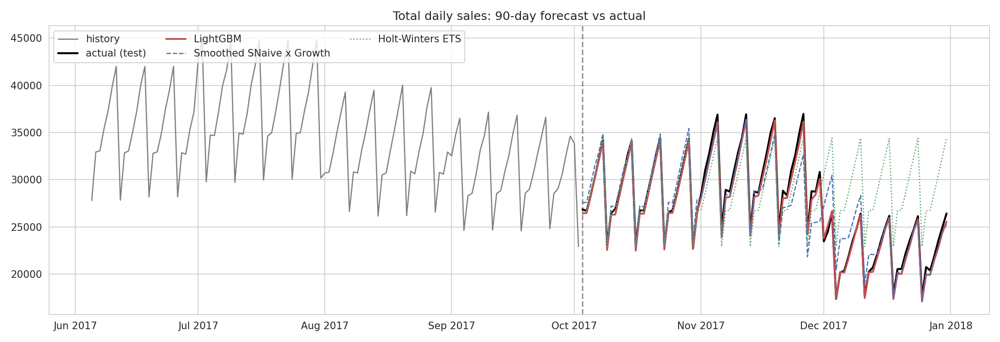
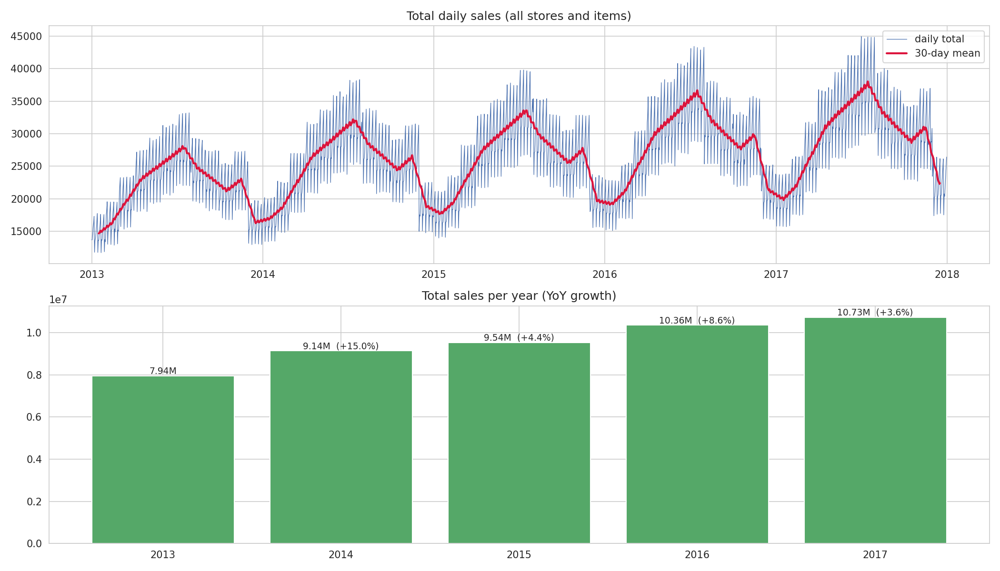
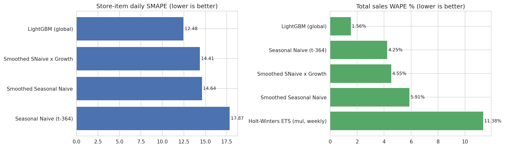
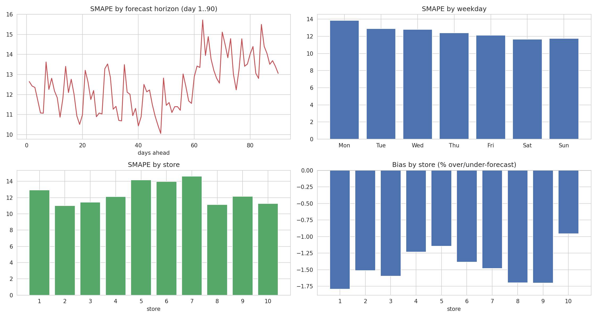
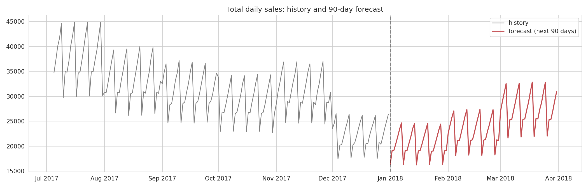

# 📈 Sales Forecasting: Store-Item Demand (LightGBM)

A 90-day demand forecasting system for **500 store-item time series** (10 stores x 50 items, 5 years of daily sales). One global **LightGBM** model is compared against seasonal-naive baselines and Holt-Winters ETS, validated with a strict time-based split, and served through an interactive **Streamlit dashboard**.

- **Notebook:** full analysis in [`notebooks/sales_forecasting.ipynb`](notebooks/sales_forecasting.ipynb)
- **Dashboard:** [`app.py`](app.py) (forecast explorer, store/item heatmap, model performance, insights)
- **Reproducible code:** [`src/forecasting.py`](src/forecasting.py), [`train.py`](train.py), [`predict.py`](predict.py), tests in [`tests/`](tests)



## Dataset

| | |
|---|---|
| Source | [Store Item Demand Forecasting Challenge (Kaggle)](https://www.kaggle.com/competitions/demand-forecasting-kernels-only) |
| Rows | 913,000 (`date, store, item, sales`) |
| Series | 500 (10 stores x 50 items) |
| Range | 2013-01-01 to 2017-12-31 (daily, no missing days) |
| Sales per row | mean 52.25, max 231 |

The data is not stored in this repo (join the competition and download `train.csv`; see [`data/README.md`](data/README.md)).



## Approach

**1. Time-based split (no random split).**

```
|---------------- train ----------------|---- validation (90d) ----|---- test (90d) ----|
 2013-12-31 -> 2017-07-04                 2017-07-05 -> 2017-10-02   2017-10-03 -> 2017-12-31
```

The test window is never used for training or tuning. LightGBM's number of rounds is chosen on validation, then the model is refit on train + validation and scored on test.

**2. Leak-free direct forecasting.** Every feature is built from data **at least 91 days old**, so a 90-day horizon needs no recursive forecasting.

| Group | Features |
|---|---|
| Lags | same-weekday lags 91 ... 140, 182, 350 ... 378, 728 |
| Rolling | mean (7 to 364 days) and std (28), shifted by 91 days |
| Same-weekday means | last 4 and 8 weeks; year-ago +/- 2 weeks |
| Growth | recent 91-day level / year-ago level |
| Calendar | weekday, month, day, day-of-year, week, quarter, month start/end, year |
| IDs | store, item (categorical) |

An automatic check hides the validation/test sales, rebuilds the features, and asserts nothing changed (`check_no_leak`). A unit test also confirms that the check actually catches a leaky feature.

**3. Models compared**

| Model | Idea |
|---|---|
| Seasonal Naive | sales on the same weekday 364 days earlier |
| Smoothed Seasonal Naive | average of the same weekday over year-ago +/- 2 weeks |
| Smoothed SNaive x Growth | the above, scaled by the recent year-over-year growth |
| Holt-Winters ETS | weekly seasonality on total sales (total level only) |
| **LightGBM (global)** | one model for all 500 series, target `log1p(sales)` |

**Metrics:** SMAPE (the competition metric), WAPE, MAE, RMSE, plus WAPE on total sales.

## Results (test set: last 90 days)

| Model | SMAPE | WAPE % | MAE | RMSE | Total-level WAPE % |
|---|---|---|---|---|---|
| Seasonal Naive (t-364) | 17.87 | 15.29 | 8.35 | 10.90 | 4.25 |
| Smoothed Seasonal Naive | 14.64 | 12.95 | 7.07 | 9.33 | 5.91 |
| Smoothed SNaive x Growth | 14.41 | 12.72 | 6.95 | 9.08 | 4.55 |
| Holt-Winters ETS (mul, weekly) | - | - | - | - | 11.38 |
| **LightGBM (global)** | **12.48** | **10.85** | **5.93** | **7.71** | **1.56** |



### Key findings

- **LightGBM beats the best baseline by 13.4% on SMAPE** (12.48 vs 14.41) and cuts total-sales WAPE from 4.55% to 1.56%. Validation SMAPE was 11.07 (best iteration 1112).
- **Yearly seasonality matters most.** About 65% of the model's gain comes from `ya_5` (year-ago same-weekday average), and another ~29% from `lag_364`, `lag_357`, `lag_371`.
- **Holt-Winters is weak here** (11.38% total WAPE) because it models only weekly seasonality and misses the yearly pattern and growth.
- **Error varies by series:** per-series SMAPE ranges from 6.8 to 23.9 (median 11.7).
- Overall bias on the test window is -1.46% (slight under-forecast).



### Honest notes

- The test period (Q4) is harder than validation, so test SMAPE (12.48) is higher than validation SMAPE (11.07).
- The model relies heavily on the year-ago pattern. A structural change (new store, promotion, price change) would not be anticipated.
- The dataset has no holidays, prices or promotions.
- These numbers are **not comparable with the Kaggle leaderboard**, which scores a different period (Jan to Mar 2018).

## Forecast

The final model is fit on the full history and forecasts **2018-01-01 to 2018-03-31** for all 500 series (`results/forecast_next_90_days.csv`, 45,000 rows).



## Dashboard

```bash
pip install -r requirements.txt
streamlit run app.py
```

- **Forecast:** pick a store and item (or all), daily or weekly view, KPIs, weekday and monthly patterns, CSV download
- **Stores & Items:** store x item heatmap, store shares, top/bottom items, leaderboard
- **Model performance:** results table, comparison charts, diagnostics
- **Insights:** feature importance, data exploration, limitations
- **Optional history overlay:** upload `train.csv` in the sidebar to add recent history, a same-period-last-year line and YoY growth

## Reproduce

```bash
# 1. download train.csv from Kaggle into data/
python train.py --data data/train.csv          # baselines, LightGBM, test scores, forecast, saved model (~5 min)

# 2. forecast with the saved model (model + history -> next 90 days)
python predict.py --data data/train.csv --model models/lgbm_sales_model.txt

# 3. tests
pip install pytest
python -m pytest -q tests
```

`train.py` uses the same code as the notebook (verified to give identical forecasts on a test dataset).

## Project structure

```
sales-forecasting-lightgbm/
├── app.py                      # Streamlit dashboard
├── train.py                    # full pipeline (CLI)
├── predict.py                  # forecast with the saved model (CLI)
├── src/
│   ├── forecasting.py          # panel, leak-free features, metrics, LightGBM, forecasting
│   └── dashboard_utils.py      # dashboard helpers
├── notebooks/sales_forecasting.ipynb
├── models/                     # lgbm_sales_model.txt, model_meta.json
├── results/                    # results.csv, feature_importance.csv, forecast_next_90_days.csv
├── images/                     # charts used in this README and dashboard
├── tests/                      # pytest suite
├── data/                       # put train.csv here (git-ignored)
└── requirements.txt
```

## Next steps

- Add holiday and promotion features (not available in this dataset)
- Quantile forecasts / prediction intervals for inventory planning
- Compare with other global models (CatBoost, N-BEATS) and a blend
- Rolling-origin backtests over several 90-day windows for a more stable estimate

## Credits

Data: Kaggle "Store Item Demand Forecasting Challenge". Licensed under the [MIT License](LICENSE).
